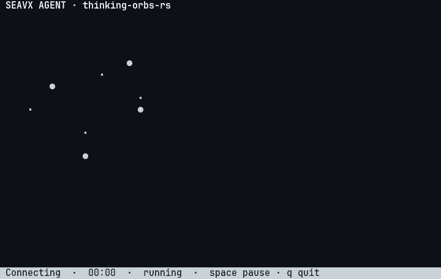

# thinking-orbs-rs

Deterministic, terminal-native orb animations for the Seavx Agent CLI.

The crate is a rendering module, not an agent runtime. It turns an agent state
and an elapsed time into particles, renders those particles as terminal glyphs,
and optionally owns a small inline terminal region. It does not call providers,
manage sessions, or replace Seavx's event loop.

## Architecture

    OrbAnimator  ->  Frame  ->  OrbRenderer  ->  characters
         ^                                      |
         |                                      v
    AgentEvent / OrbState                 TerminalOrb (optional)

- **Core** (`animator`, `state`, `config`, `frame`, `particle`,
  `geometry`, `algorithms`) is pure and deterministic. It never reads the
  clock and never writes to stdout.
- **Renderer** maps particles to Unicode or ASCII characters and can emit ANSI
  color only when explicitly enabled.
- **Terminal adapter** owns cursor visibility and the inline redraw region. It
  is a no-op when stdout is not a TTY.

The core can be embedded in an existing TUI. Do not run `TerminalOrb` next to
another renderer that owns stdout; use `OrbAnimator` plus `OrbRenderer`
inside the existing render loop instead.

## Quick start

```toml
[dependencies]
thinking-orbs-rs = { path = "crates/thinking-orbs-rs" }
```

```rust
use std::time::Duration;
use thinking_orbs_rs::{AgentEvent, OrbConfig, TerminalOrb};

fn main() -> std::io::Result<()> {
    let mut orb = TerminalOrb::new(OrbConfig::default())?;
    orb.handle_event(&AgentEvent::RunStarted);

    // Drive this from the agent's existing render tick.
    orb.tick(Duration::from_millis(16))?;
    Ok(())
}
```

For a pure animation frame:

```rust
use thinking_orbs_rs::{OrbAnimator, OrbConfig, OrbRenderer, OrbState};

let mut animator = OrbAnimator::new(OrbConfig::default());
animator.set_state(OrbState::Searching);
let frame = animator.frame_at(1.25);
let text = OrbRenderer::new(
    thinking_orbs_rs::OrbStyle::Unicode,
    thinking_orbs_rs::OrbTheme::Dark,
)
.render(&frame);
println!("{text}");
```

## Demo



A real capture of `cargo run --example agent` at 80x24: the orb follows the
agent state while the transcript streams tool calls and the reply. A still is
available at [docs/agent-demo.png](docs/agent-demo.png).

## Examples

```sh
cargo run --example gallery          # every state, side by side
cargo run --example gallery -- --static

cargo run --example agent            # scripted AI-agent terminal UI
cargo run --example agent -- --ascii
cargo run --example agent -- --static
```

The interactive gallery cycles through the nine animations plus idle. Use the
left and right arrow keys to switch states, and `q`, `Esc`, or `Ctrl+C` to
exit. The static mode prints a plain ASCII preview and works without a TTY.

The agent demo builds a small terminal UI around the orb: a header, a
transcript of tool calls, a streaming reply, the live orb, and a status bar.
It drives `OrbAnimator` + `OrbRenderer` directly instead of `TerminalOrb`
because it owns the whole screen. `space` pauses the orb; `q`/`Esc`/`Ctrl+C`
quits. When stdout is not a TTY it prints the finished transcript instead.

## States

| State        | Visual pattern                            |
| ------------ | ----------------------------------------- |
| `Idle`       | Quiet drifting rings                      |
| `Working`    | Tilted orbital paths                      |
| `Searching`  | Fibonacci sphere with a scanning meridian |
| `Solving`    | Deterministic scramble that converges     |
| `Listening`  | Concentric rings with travelling waves    |
| `Connecting` | Progressively revealed constellation      |
| `Weaving`    | Three interlaced parametric strands       |
| `Composing`  | Multi-band latitude ribbons               |
| `Breathing`  | Symmetric expanding ring                  |
| `Shaping`    | Circle / triangle / square morph          |

All nine algorithms share the same pipeline: normalized 3D positions, mild
perspective, depth sorting, scaling to the logical terminal canvas, and
intensity mapping. See [docs/thinking-orbs.md](docs/thinking-orbs.md) for the
algorithm notes and integration details.

## Lifecycle mapping

`state_for_event` maps the integration-facing `AgentEvent` enum to a state.
Tool names are treated as hints, not as the only source of truth:

| Event                  | State                                |
| ---------------------- | ------------------------------------ |
| `RunStarted`           | `Working`                            |
| `ProviderConnecting`   | `Connecting`                         |
| `ProviderConnected`    | `Working`                            |
| `ToolStarted { name }` | State derived from the tool category |
| `ToolFinished`         | `Working`                            |
| `ResponseStarted`      | `Composing`                          |
| `ResponseFinished`     | `Idle`                               |
| `AwaitingInput`        | `Listening`                          |
| `Failed` / `Cancelled` | `Idle`                               |

In a real Seavx integration, translate the existing agent event type into
`AgentEvent` (or call `OrbAnimator::set_state` directly when the event
already carries an explicit stage). Do not couple animation code to an
individual provider.

## Configuration

```rust
use thinking_orbs_rs::{OrbConfig, OrbSize, OrbStyle, OrbTheme};

let config = OrbConfig {
    size: OrbSize::Compact,
    style: OrbStyle::Ascii,
    theme: OrbTheme::Dark,
    speed: 1.2,
    fps: 20,
    reduced_motion: false,
};
```

- `speed` must be finite and greater than zero. Invalid values are repaired to
  `1.0` by `OrbAnimator::new`; use `OrbConfig::validate` to reject them.
- `fps` is clamped to `1..=30`.
- `reduced_motion` freezes visual time at zero while keeping rendering active.
- `theme` affects the ANSI grayscale ramp only. `Auto` currently resolves to `Dark`; the palette is white/gray with no hue.
- `OrbSize::Compact` is `28x14` cells; `OrbSize::Normal` is `48x24`.

## Terminal behavior

- Non-TTY output produces no ANSI animation. `TerminalOrb::tick` advances the
  animator but writes nothing.
- ANSI color is disabled when `NO_COLOR` is set.
- The terminal adapter never clears the whole screen and never removes earlier
  conversation output. It redraws only the lines it owns.
- Cursor visibility is restored on `clear`, normal drop, and panic unwind.
  The library does not install signal handlers; a host that owns SIGINT should
  call `clear` or drop the adapter in its cancellation path.

## Determinism and performance

`frame_at(t)` is a pure function of the state, configuration, and `t`. It does
not read the system clock and performs no I/O. `tick(delta)` advances the
internal clock and reuses the animator's particle buffer. Frame rate is capped
at 30 FPS by configuration, and `TerminalOrb` coalesces draws to the configured
interval even if the host ticks faster. Rendering is synchronous and must be
driven from a host thread or task that does not block provider streaming.

## Verification

```sh
cargo fmt --all -- --check
cargo clippy --workspace --all-targets -- -D warnings
cargo test --workspace
cargo check --workspace --all-targets
```

## Limitations

- The renderer is terminal-only; there is no browser, Canvas, WebAssembly, or
  GPU backend.
- `OrbTheme::Auto` cannot reliably detect a terminal background color.
- The library does not own keyboard input, provider connections, or session
  state.
- The algorithms port the reference's geometry, presets, and timing to
  `f32`/`f64`. The output is not pixel-identical: a terminal cell can only
  hold one glyph, so sub-pixel dots and stroked lines become sampled dot fields.

## License and attribution

MIT © 2026 MUHAMMAD ADRIANSYAH. See [LICENSE](LICENSE).

The visual direction is inspired by
[Jakubantalik/thinking-orbs](https://github.com/Jakubantalik/thinking-orbs),
which is distributed under the MIT license. This crate is a Rust adaptation of
that engine for terminal character grids. The reference project's copyright and
license notice are preserved above.
